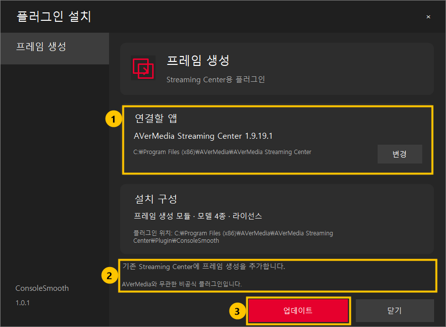

# ConsoleSmooth 처음 쓰는 분을 위한 사용법

[English](GUIDE.md) · [README로 돌아가기](../README.ko.md)

처음 설치하는 분이 그대로 따라 할 수 있게 순서대로 정리했어요. 막히는 곳이 있으면 맨 아래 [문제 해결](#문제-해결)부터 봐 주세요.

## 1. 준비물

- **AVerMedia 캡처보드**와 **AVerMedia Streaming Center** 1.8.22.2 또는 최신 1.9.19.1 (x64)
  - 확인한 캡처보드: Live Gamer 4K(GC573), GC313 Pro, GC553 Pro
  - 엘가토 등 다른 회사 캡처보드나 OBS에서는 동작하지 않아요.
- Streaming Center에서 **콘솔 화면이 미리보기에 잘 나오는 상태**
- **그래픽카드**: 최소 AMD Radeon RX 6600. NVIDIA Video Frame Generation·DLSS 프레임 생성은 RTX 40/50. 지포스는 FSR 3 기준 RTX 2060급, RIFE 기준 RTX 3070·4060급 이상(근사 측정)
- **120Hz 이상 모니터**: 60Hz 모니터에서는 생성된 프레임이 보이지 않아요.
- Windows x64

콘솔(스위치·PS5)은 아무것도 바꾸지 않아요. PC에 들어온 캡처 화면만 처리해요.

## 2. 설치 파일 받기

1. [Releases](https://github.com/GamKim/consolesmooth/releases/latest) 페이지에서 `ConsoleSmooth-Plugin-Setup-1.1.4.exe`를 받아요.
2. 서명이 없는 설치 파일이라 실행하면 Windows가 "PC 보호" 경고를 띄울 수 있어요. **추가 정보 → 실행**을 누르세요.
   - 걱정되면 같은 페이지의 `SHA256SUMS-1.1.4.txt` 값과 받은 파일의 해시를 비교해 보세요(PowerShell: `Get-FileHash 파일이름`).

## 3. 설치하기

> **먼저 Streaming Center를 완전히 꺼 주세요.** 창을 닫아도 뒤에서 계속 실행 중일 수 있어요. 화면 오른쪽 아래 트레이(^ 아이콘 안)에 아이콘이 있으면 오른쪽 클릭해서 종료하고, 작업 관리자(Ctrl+Shift+Esc)에 Streaming Center가 남아 있지 않은지 확인하세요.

1. **① 연결할 앱**에 `AVerMedia Streaming Center 1.9.19.1`처럼 버전이 나오는지 확인해요.
   - "공식 앱을 먼저 설치하세요"라고 나오거나 다른 곳에 설치했다면 **변경**을 눌러 Streaming Center 설치 폴더를 직접 골라요.
     (기본 위치: `C:\Program Files (x86)\AVerMedia\AVerMedia Streaming Center`)
2. **③ 설치** 버튼을 눌러요. 이미 설치돼 있으면 버튼이 **업데이트**로 보여요.
3. Windows **사용자 계정 컨트롤**(관리자 권한 확인) 창이 뜨면 **예**를 눌러요.
   - 이 창이 다른 창 뒤에 숨어서 안 보일 때가 있어요. 작업 표시줄에서 깜빡이는 방패 아이콘을 확인해 주세요.
4. 맨 위 제목이 **"설치 완료"**로 바뀌면 끝이에요. **완료**를 눌러 닫아요.

**설치를 눌러도 아무 변화가 없어 보이면** ② 자리의 회색 글씨를 읽어 주세요. 오류 내용이 여기에 나와요.

| ②에 나오는 글 | 해결 방법 |
|---|---|
| 설치 또는 제거 전에 Streaming Center를 닫아주세요. | 트레이·작업 관리자까지 확인해 Streaming Center를 완전히 끄고 다시 설치를 눌러요. |
| 공식 AVerMedia Streaming Center 설치 폴더가 필요합니다. 공식 앱을 먼저 설치하세요. | Streaming Center를 설치하거나, **변경**으로 설치 폴더를 직접 골라요. |
| "취소되었습니다"처럼 취소를 뜻하는 문구 | 관리자 확인 창에서 "아니요"를 누른 경우예요. 다시 설치를 누르고 **예**를 눌러요. |
| 작업을 완료하지 못했습니다. 관리자 창의 오류를 확인하세요. | 관리자 권한으로 설치하다 멈춘 경우예요. 아래 [문제 신고](#문제-신고)로 알려 주세요. |

## 4. 처음 켜기

1. 평소처럼 **Streaming Center 아이콘으로 실행**해요(설치가 바로가기를 바꾸지 않아요).
2. 미리보기 위 툴바에 **아이콘 두 개**가 새로 생겨요. 마우스를 올리면 이름이 나와요.
   - **프레임 생성 켜기**: 생성을 켜고 끄는 버튼
   - **프레임 생성 설정**: 설정 창을 여는 버튼
   - 처음에는 꺼져 있어요.
3. **콘솔을 켜서 게임 화면이 들어오는 상태**에서 **프레임 생성 설정**을 눌러요.

   

4. 아래쪽 **권장 설정**을 눌러요. 약 25초 동안 이 PC에서 실제로 생성해 보고, 그래픽카드와 모니터에 맞는 설정(모델·배수·지연·화면 동기화)을 골라 줘요. 그동안 잠깐 기다려 주세요.
5. 결과 창에서 **적용**을 누르고 설정 창을 **닫기**로 닫아요.
6. 툴바의 **프레임 생성 켜기**를 누르거나 단축키 **Ctrl+Alt+F**를 눌러요. 이제 켜졌어요!
   - 화면 구석에 `입력 / 지금 fps` 숫자가 나와요. 예를 들어 60fps 입력을 2배로 켜면 `60 / 120`이에요.

> **게임할 때는 전체 화면으로 보세요.** 프레임 생성 탭 → 표시 방식에서 **전체 화면**을 고르면 **저지연 보기가 자동으로 같이 켜져요.** 이때 지연이 가장 짧아요(원본보다 약 9\~19ms, 2배 기준). **창**은 Streaming Center 화면을 보면서 녹화를 확인할 때만 쓰세요. 창은 지연이 더 길어요.
> 처음 바꿨다면 Streaming Center를 한 번 다시 시작해 주세요. 설정 창에 다시 시작하라는 안내가 나오면 그때도 다시 시작하면 돼요.

## 5. 끄기

- 같은 버튼(**프레임 생성 끄기**로 바뀜)이나 **Ctrl+Alt+F**를 다시 눌러요. 끄면 원래 미리보기 그대로예요.
- **전체 화면**으로 볼 때는 **Esc**를 누르면 전체 화면이 닫히면서 생성도 꺼져요. 다시 켜면 전체 화면으로 열려요.
- 전체 화면은 **다른 프로그램 창을 눌러도 닫히지 않아요.**
  - 다른 모니터의 창(디스코드, 브라우저 등)을 쓰는 동안에는 전체 화면이 그대로 맨 앞에 있어요. 지연도 그대로예요.
  - 같은 모니터의 창을 누르면(Alt+Tab 등) 전체 화면이 그 창 뒤로 잠시 물러나요. 전체 화면을 다시 누르거나 Alt+Tab으로 돌아오면 다시 맨 앞에 나와요.
  - 전체 화면이 뒤에 있을 때도 켜기/끄기 단축키(기본 **Ctrl+Alt+F**)로 끌 수 있어요.

## 6. 자주 바꾸는 설정

설정 창에서 바꾼 값은 **적용**을 눌러야 저장되고, **다음에 켤 때** 반영돼요. 켜져 있는 동안 바꿨다면 한 번 껐다 켜 주세요.

| 하고 싶은 것 | 설정 위치 |
|---|---|
| 화질이 더 좋게 / 더 가볍게 | 프레임 생성 탭 → 모델: **RIFE 4.15 lite**·**NVIDIA Video Frame Generation**(화질) / **FSR 3**·**AMD FSR 프레임 생성**(가벼움) |
| 지연을 가장 짧게 (게임할 때) | 프레임 생성 탭 → 표시 방식: **전체 화면** (저지연 보기가 같이 켜짐), 2배. 바꾼 뒤 Streaming Center를 다시 시작 (원본보다 약 9\~19ms) |
| 160Hz 같은 모니터에 맞추기 | 프레임 생성 탭 → 출력 방식: **목표 프레임**을 모니터 Hz로 |
| 30fps 게임(GTA5 화질 모드, 블러드본)을 고르게 | 고급 탭 → **30fps 보정**(지연 약 +8ms, 기본 끔) |
| 머리·테두리 번짐 대신 고른 간격을 원할 때 | 표시·녹화 탭 → **만든 장 짧게 보이기** 끄기 (기본 켬: 만든 프레임 약 8ms, 원본 약 25ms) |
| 전체 화면을 HDR로 보기 (NVIDIA RTX + HDR 모니터) | 고급 탭 → **RTX Video HDR** 켜기 (Windows HDR이 꺼져 있으면 전체 화면 동안만 자동으로 켬. 오른쪽 위에 NVIDIA의 "RTX HDR" 표시가 나오는 것은 정상) |
| 글자 창·지도 같은 HUD가 깨져 보일 때 | 고급 탭 → **HUD 보호** 끄기 |
| 생성 프레임까지 녹화·방송 | 표시 · 녹화 탭 → 녹화 소스 **생성 프레임 포함** (녹화·방송을 먼저 시작하고 생성은 나중에 켜도 됩니다) |
| 켜기/끄기 단축키 바꾸기 | 고급 탭 → **켜기/끄기 단축키** |

**120fps로 녹화할 때는 비트레이트를 꼭 올려 주세요.** Streaming Center 설정 → 녹화 설정 → 동영상 비트율을 40000\~50000으로 올리세요. 기본 15000이면 풀숲 같은 곳이 뭉개져요.

### 녹화·방송하면서 쓰기

1. 표시 · 녹화 탭 → 녹화 소스를 **생성 프레임 포함**으로 둡니다.
2. Streaming Center에서 녹화나 방송을 먼저 시작합니다. 처음부터 출력 fps(예: 120fps)로 저장·전송됩니다.
3. 켜기 단축키로 생성을 켭니다. 전체 화면이 열려도 녹화·방송은 계속됩니다.
4. 끝낼 때는 Esc(전체 화면을 닫고 생성 끄기) → Streaming Center에서 녹화·방송 멈추기.

- 생성이 꺼진 동안은 같은 장면이 두 번씩 들어갑니다. 생성을 켜면 그때부터 만든 프레임이 들어갑니다.
- 1초에 들어가는 새 화면 = 게임 fps × 배수. 60fps 게임 2배 → 120장, 30fps 게임(GTA5 등) 2배 → 60장, 4배 → 120장.
- 3배·4배를 빠른 방식(전체 화면)으로 쓰려면 NVIDIA VFG나 RIFE를 고르세요. FSR 3·DLSS 프레임 생성·AMD FSR 프레임 생성의 3배·4배는 보통 방식이라 지연이 조금 깁니다.
- Streaming Center는 방송 설정의 주사율(60)과 상관없이 미리보기와 같은 fps(예: 120fps)로 방송을 내보냅니다. 방송하기 전에 방송 사이트가 120fps를 받는지 확인하세요.

## 문제 해결

**툴바에 아이콘이 안 보여요**
- Streaming Center 버전이 1.8.22.2나 1.9.19.1인지 확인해 주세요.
- Streaming Center를 트레이·작업 관리자까지 완전히 껐다가 다시 켜 보세요. 1.9.19.1은 설치할 때 더한 사용자 환경 변수(`GST_TRACERS`)로 플러그인을 켜는데, 설치 전에 실행된 프로그램에는 이 값이 늦게 들어갈 수 있어요. 그래도 안 보이면 **Windows를 로그아웃했다가 다시 로그인**(또는 재시작)해 주세요.

**켰는데 부드럽지 않아요 / 숫자가 안 올라가요**
- 모니터가 120Hz 이상으로 설정돼 있는지 확인해요(Windows 설정 → 디스플레이 → 고급 디스플레이 → 새로 고침 빈도).
- **권장 설정**을 다시 눌러 보세요. 그래픽카드 여유가 적으면 **FSR 3**를 골라 줘요.
- 다른 게임이나 프로그램이 그래픽카드를 많이 쓰면 생성이 모자랄 수 있어요.
- PS5는 **HDR을 꺼 주세요**(HDR·10비트는 지원하지 않아요).

**"입력 신호 없음"이라고 나와요**
- 콘솔 화면이 Streaming Center 미리보기에 들어오는지 먼저 확인해요. 입력 신호가 없으면 생성하지 않고 원본을 그대로 보여 줘요.

**지연이 느껴져요**
- 미리보기를 보면서 하는 방식이라 모니터 직결(패스스루)보다는 늦어요. 대전·리듬 게임은 패스스루를 추천해요.
- 게임할 때는 **전체 화면**을 쓰세요(저지연 보기가 같이 켜져요). 창은 지연이 더 길어요. 측정값은 [README](../README.ko.md)에 있어요.
- 설정 창 맨 아래 상태 줄의 `원본→화면 X ms`는 프로그램 안에서 잰 값이에요. 캡처보드·모니터 지연은 빠져 있어요([측정 방법](MEASUREMENT.ko.md)).

**글자·HUD가 깨져 보여요**
- 고급 탭에서 **HUD 보호**를 꺼 보세요(반투명 글자 창, 게임 속 웹페이지, 가운데 오래 서 있는 3인칭 캐릭터에서 생길 수 있어요).

## 제거

Streaming Center를 끄고, 플러그인 폴더의 `Uninstall.exe`를 실행해 **제거**를 눌러요.
기본 위치: `C:\Program Files (x86)\AVerMedia\AVerMedia Streaming Center\Plugin\ConsoleSmooth`
Streaming Center와 사용자 설정은 그대로 남아요.

## 문제 신고

설정 창 고급 탭의 **진단 정보 내보내기**를 누르면 텍스트 파일이 하나 저장돼요(장비·설정·최근 기록, 자동 전송 없음).
그 파일을 [Issues](https://github.com/GamKim/consolesmooth/issues)에 첨부해 주시면 더 빨리 고칠 수 있어요.
