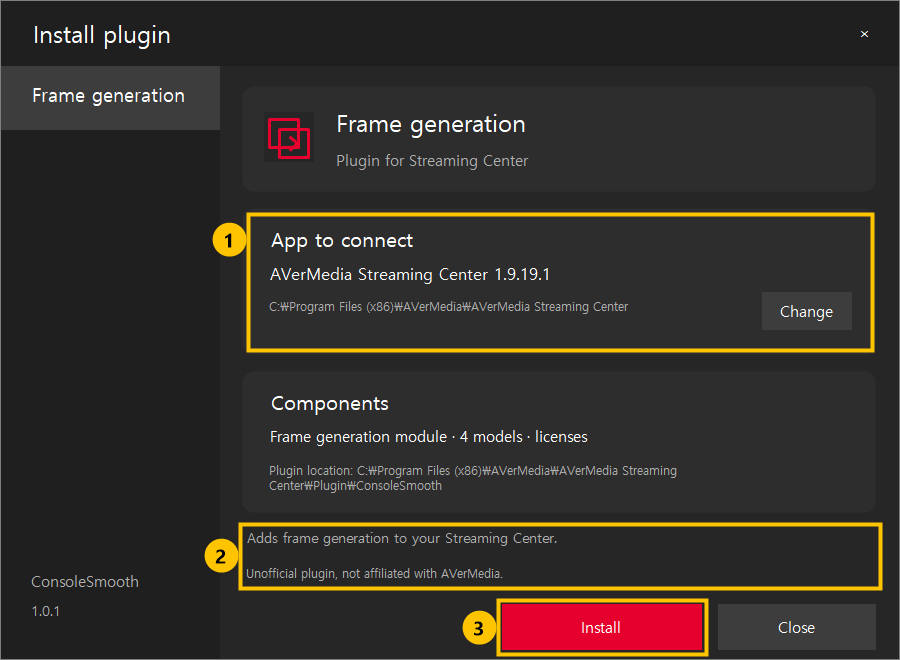
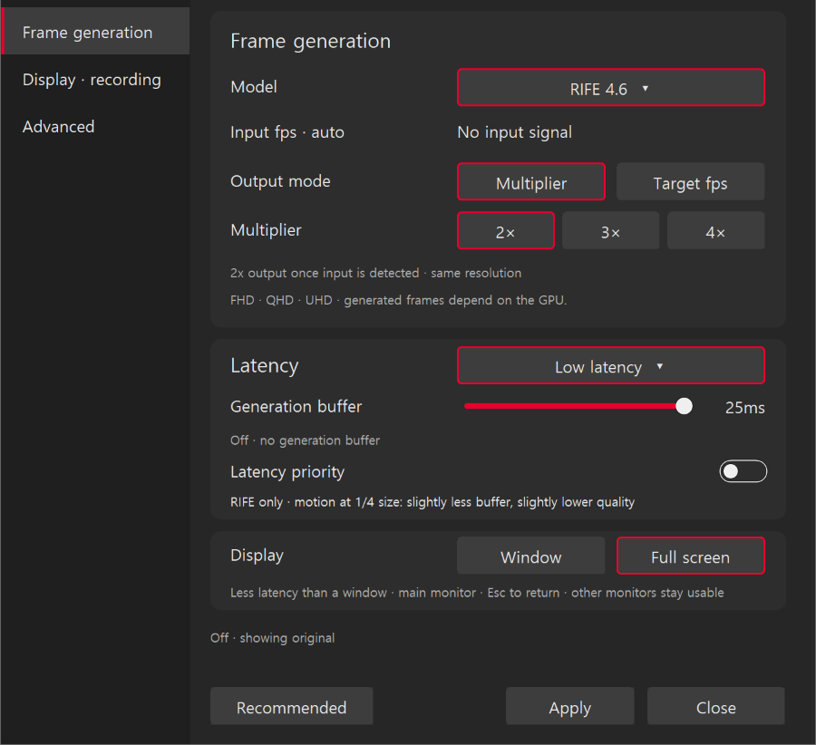

# ConsoleSmooth: step-by-step guide for first-time users

[한국어](GUIDE.ko.md) · [Back to README](../README.md)

Follow these steps in order. If something doesn't work, jump to [Troubleshooting](#troubleshooting).

The installer and the settings window are in English unless your Streaming Center is set to Korean.

## 1. What you need

- An **AVerMedia capture card** and **AVerMedia Streaming Center** 1.8.22.2 or the latest 1.9.19.1 (x64)
  - Tested cards: Live Gamer 4K (GC573), GC313 Pro, GC553 Pro
  - It does not work with other brands (Elgato etc.) or in OBS.
- Your console picture already showing in the Streaming Center preview
- **GPU**: minimum AMD Radeon RX 6600. NVIDIA Video Frame Generation and DLSS Frame Generation need RTX 40/50. On GeForce about RTX 2060 class with FSR 3, RTX 3070 / 4060 class or better with RIFE (approximate test)
- A **120 Hz or faster monitor**: on a 60 Hz monitor the generated frames can't be seen.
- Windows x64

Nothing on the console (Switch, PS5) is changed. Only the captured picture on your PC is processed.

## 2. Download

1. Download `ConsoleSmooth-Plugin-Setup-1.1.2.exe` from the [latest release](https://github.com/GamKim/consolesmooth/releases/latest).
2. The installer isn't code-signed, so Windows may show a "Windows protected your PC" warning. Click **More info → Run anyway**.
   - If you want to check the file, compare its hash with `SHA256SUMS-1.1.2.txt` on the same page (PowerShell: `Get-FileHash <file>`).

## 3. Install

> **Close Streaming Center completely first.** Closing the window may leave it running in the background. If it has an icon in the tray (bottom right, under ^), right-click it and exit, and check Task Manager (Ctrl+Shift+Esc) that Streaming Center is gone.

(The installer's font draws the backslash in folder paths as ₩, so `C:₩Program Files` means `C:\Program Files`.)

1. **① App to connect** should show your version, for example `AVerMedia Streaming Center 1.9.19.1`.
   - If it says "Install the official app first", or you installed Streaming Center somewhere else, click **Change** and pick the Streaming Center folder
     (default: `C:\Program Files (x86)\AVerMedia\AVerMedia Streaming Center`).
2. Click **③ Install**. If it's already installed, the button says **Update**.
3. When Windows **User Account Control** asks for permission, click **Yes**.
   - That prompt sometimes opens behind other windows. Look for a flashing shield icon on the taskbar.
4. When the title changes to **"Installed"**, you're done. Click **Done**.

**If nothing seems to happen after clicking Install**, read the grey text at **②**. Errors are shown there.

| Text at ② | What to do |
|---|---|
| Close Streaming Center before installing or uninstalling. | Close Streaming Center completely (tray and Task Manager) and click Install again. |
| The official AVerMedia Streaming Center install folder is required. Install the official app first. | Install Streaming Center, or click **Change** and pick its folder. |
| A message saying the operation was cancelled | You clicked "No" in the User Account Control prompt. Click Install again and choose **Yes**. |
| Could not finish. Check the error in the administrator window. | The elevated install stopped. Please [report it](#reporting-a-problem). |

## 4. Turn it on the first time

1. Start Streaming Center **from your usual icon** (the installer doesn't change shortcuts).
2. **Two new icons** appear on the toolbar above the preview. Hover over them to see their names:
   - **Turn frame generation on**: turns generation on and off
   - **Frame generation settings**: opens the settings window
   - Generation starts off.
3. With your **console on and the game picture coming in**, click **Frame generation settings**.

   

4. Click **Recommended** at the bottom. For about 25 seconds it really generates frames on your PC, then suggests settings for your GPU and monitor (model, multiplier, latency, display sync). Please wait while it runs.
5. In the result window click **Apply**, then close the settings window with **Close**.
6. Click **Turn frame generation on** on the toolbar, or press **Ctrl+Alt+F**. It's on!
   - A readout `input / now fps` appears in a corner. For example, a 60 fps input at 2x shows `60 / 120`.

## 5. Turn it off

- Click the same button (now **Turn frame generation off**) or press **Ctrl+Alt+F** again. Off means the normal preview.
- In **full screen**, **Esc** closes full screen and turns generation off. Turning it on again opens full screen.

## 6. Settings people change most

Changes in the settings window are saved with **Apply** and take effect **the next time you turn it on**. If it's on while you change things, turn it off and on once.

| I want to… | Where |
|---|---|
| Better quality / lighter on the GPU | Frame generation tab → Model: **RIFE 4.15 lite** or **NVIDIA Video Frame Generation** (quality) / **FSR 3** or **AMD FSR Frame Generation** (light) |
| Lowest latency | Display tab → turn **Low latency view** on + full screen, 2x, then restart Streaming Center (about 9-19 ms after the original) |
| Match a 160 Hz (or other) monitor | Frame generation tab → Output mode: **Target fps** = your refresh rate |
| Shave latency | Frame generation tab → Display: **Full screen** (shorter than a window) |
| Even spacing instead of less smear | Display tab → turn **Show generated frames briefly** off (on by default: generated about 8 ms, original about 25 ms) |
| Even pacing in 30 fps games (GTA V quality mode, Bloodborne) | Advanced tab → **30fps smoothing** (about +8 ms latency, off by default) |
| Fix broken HUD, text boxes or maps | Advanced tab → turn **HUD protection** off |
| Record and stream the generated frames | Display · recording tab → Recording source **With generated** (you can start recording or streaming first and turn generation on later) |
| Change the on/off shortcut | Advanced tab → **On/off shortcut** |

**Raise the bitrate for 120 fps recordings.** Streaming Center settings → recording settings → video bitrate 40000-50000. The default 15000 smears detail such as grass.

### Recording and streaming while you play

1. Display · recording tab → set Recording source to **With generated**.
2. Start recording or streaming in Streaming Center first. It runs at the output rate (e.g. 120 fps) from the start.
3. Turn generation on with the shortcut. With the low latency view on, the full screen opens and recording and streaming keep going.
4. To finish: Esc (closes the full screen and turns generation off), then stop recording or streaming in Streaming Center.

- While generation is off, each picture is repeated. Generated frames go in from the moment you turn it on.
- New pictures per second = game fps × multiplier: 60 fps game at 2x → 120, 30 fps game (GTA V and so on) at 2x → 60.
- Streaming Center streams at the preview rate (e.g. 120 fps) whatever frame rate the stream settings show (60). Check that your streaming site accepts 120 fps before you go live.

## Troubleshooting

**The toolbar icons don't appear**
- Check that Streaming Center is 1.8.22.2 or 1.9.19.1.
- Close Streaming Center completely (tray and Task Manager) and start it again. On 1.9.19.1 the plugin is turned on by a user environment variable (`GST_TRACERS`) that the installer adds, and programs started before the install may not see it yet. If the icons still don't appear, **sign out of Windows and back in** (or restart).

**It's on but not smoother / the numbers don't go up**
- Make sure your monitor runs at 120 Hz or more (Windows Settings → Display → Advanced display → refresh rate).
- Run **Recommended** again. If your GPU has little headroom it picks **FSR 3**.
- Other games or programs using the GPU can make generation fall short.
- On PS5, **turn HDR off** (HDR / 10-bit isn't supported).

**It says "No input signal"**
- First check that the console picture reaches the Streaming Center preview. Without an input signal it doesn't generate and shows the original.

**I can feel the delay**
- You play while watching the preview, so it's later than passthrough (console straight to the monitor). For fighting and rhythm games use passthrough.
- **Full screen** has less latency than a window. Measurements are in the [README](../README.md).

**Letters or HUD look broken**
- Turn **HUD protection** off in the Advanced tab (it can happen with see-through text boxes, in-game web pages, or a third-person character standing still in the middle).

## Uninstall

Close Streaming Center, run `Uninstall.exe` in the plugin folder and click **Uninstall**.
Default location: `C:\Program Files (x86)\AVerMedia\AVerMedia Streaming Center\Plugin\ConsoleSmooth`
Streaming Center and your settings are kept.

## Reporting a problem

Click **Export diagnostics** in the Advanced tab of the settings window. It saves one text file (hardware, settings, recent log; nothing is sent automatically).
Attach that file to an [issue](https://github.com/GamKim/consolesmooth/issues) so it can be fixed faster.
